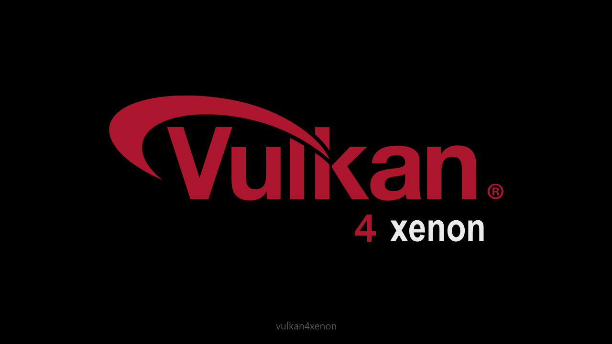

<div align="center">
  
</div>

# vulkan4xenon

A Vulkan 1.0 subset for the Xbox 360, built as a static library on the xsdk homebrew SDK's GPU layer, which drives
Xenos directly under the retail kernel.

The goal is running Dusklight, a reimplementation of Twilight Princess built on encounter's Aurora, on an RGH console.

**Status:** milestones 1 (a triangle), 2 (textures, descriptors and push constants), 3 (pipeline state), 4 (render
to texture), 5 (the benchmark), 6 (the replay's cost) and 7 (uniform blocks the GPU loads) passed on the console on
2026-10-11. docs/ROADMAP.md is the plan, and docs/SUPPORT.md lists what exists.

## Shaders

Apps pass standard SPIR-V to `vkCreateShaderModule`. Shaders are compiled offline into Xenos containers, bundled with
the app and looked up by their SPIR-V. `tools/build_shaders.py` does it: GLSL → `glslang -V` → xost → a C source with
each shader's SPIR-V and the bundle.

```
python3 tools/build_shaders.py --xost ../Xbox-360-SDK/xenos-toolchain --output tests/shaders tests/shaders/*.vert tests/shaders/*.frag
```

## Building

The layer builds with xsdk's toolchain in WSL Debian, against an xsdk checkout next to this one (`XSDK=` points
elsewhere). Build xsdk first, then:

```
make
```

That makes `build/libvulkan4xenon.a`, the test title, `build/vulkan4xenon_test.xex`, and the benchmark,
`build/vkbench.xex`.

## Benchmark

vkbench runs the same scenes through xsdk's GPU layer and then through vulkan4xenon, with
the same shaders, and logs each frame's draw + submit and GPU time for both, what xsdk's ring did, and whether they
drew the same picture.
Every frame goes in `game:\vkbench_frames.csv` and the summary in `game:\vkbench_summary.csv`. docs/ROADMAP.md,
milestone 5, has the scenes and how they're timed.

## Licence

vulkan4xenon is under the MIT licence (LICENSE), copyright Mena. THIRD_PARTY_NOTICES.md lists the code from elsewhere
in the repository and points to xsdk's notices, which every title built on it ships.

## Trademarks

The Vulkan logo is a registered trademark of the Khronos Group, used here at the project owner's choice. vulkan4xenon
doesn't claim conformance. vulkan4xenon isn't affiliated with or endorsed by Microsoft; Xbox and Xbox 360 are
trademarks of Microsoft, and the repository holds no Microsoft code.
